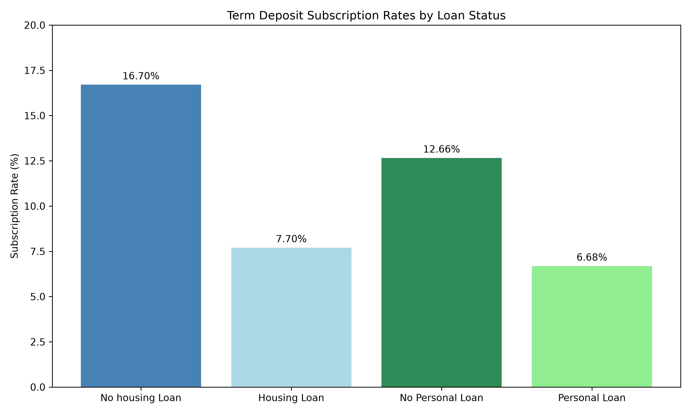

# Bank Marketing Analytics & Response Prediction

## Project Overview

Banks use direct marketing campaigns to promote financial products such as term deposits. However, contacting large numbers of customers can be costly and inefficient.

This project analyzes customer demographics, financial characteristics, and marketing interactions to identify patterns associated with successful term deposit subscriptions.

The project follows an end-to-end analytics workflow involving data preparation, exploratory analysis, customer segmentation, SQL, statistical hypothesis testing, predictive modeling, and business intelligence.

**Project objective:** Use historical customer and campaign data to generate actionable insights and ultimately develop predictive models that could support more efficient marketing decisions within financial services.

---

## Data Source

This project uses the **Bank Marketing Dataset** from the UCI Machine Learning Repository.

The dataset contains information from direct marketing campaigns conducted by a Portuguese banking institution, primarily through telephone contact.

**Dataset:** `bank-full.csv`

**Records:** 45,211

**Variables:** 17

**Target variable:** `y`, indicating whether a customer subscribed to a term deposit.

**Source:** [UCI Machine Learning Repository](https://archive.ics.uci.edu/dataset/222/bank+marketing)

**Creators:** Sérgio Moro, Paulo Rita, and Paulo Cortez

**DOI:** 10.24432/C5K306

---

## Business Problem

**How can a bank improve direct marketing efficiency by identifying customer and campaign characteristics associated with higher term deposit subscription rates?**

The project investigates:

- Which customer characteristics are associated with successful subscriptions?
- How do housing loans, personal loans, and account balances relate to subscription behavior?
- How does marketing contact frequency relate to subscription outcomes?
- Which customer segments demonstrate higher historical response rates?
- Are selected relationships statistically significant?
- Can machine learning predict subscription outcomes using information available before marketing contact?

The ultimate goal is to translate analytical findings into recommendations that support customer segmentation and marketing decisions.

---

## Tools & Technologies

### Currently Used

- Python
- pandas
- NumPy
- Matplotlib
- SciPy
- statsmodels
- Jupyter Notebook
- SQL
- SQLite
- Visual Studio Code
- Git
- GitHub

### Planned for Later Phases

- scikit-learn
- Logistic Regression
- Classification Model Evaluation
- Power BI

---

# Project Workflow

## Phase 1 — Data Preparation ✅

Initial data preparation focused on understanding and validating the dataset.

Tasks completed:

- Imported the raw dataset using pandas
- Inspected dataset dimensions and structure
- Reviewed column data types
- Examined missing and unknown values
- Validated important variables
- Reviewed subscription outcomes
- Prepared data for exploratory analysis

The dataset contains **45,211 customer records and 17 variables**.

## Phase 2 — Exploratory Data Analysis ✅

Exploratory analysis examined the distributions of customer demographics, financial characteristics, and marketing campaign variables.

### Customer Characteristics

- Age
- Occupation
- Marital status
- Education
- Credit default status
- Housing loan status
- Personal loan status
- Account balances

### Marketing Characteristics

- Contact method
- Contact month
- Campaign activity
- Subscription outcome

Visualizations were created using Matplotlib to examine distributions and identify patterns.

**Notebook:** [Data Exploration](notebooks/01_data_exploration.ipynb)

## Phase 3 — Comparative Customer Analysis ✅

Comparative analysis investigated differences in subscription behavior across customer groups.

Analyses included:

- Overall subscription rate
- Subscription rates by occupation
- Subscription rates by age group
- Account balance comparisons
- Housing loan status and subscription behavior
- Personal loan status and subscription behavior
- Contact method comparisons
- Campaign contact frequency
- Previous campaign outcomes
- Multivariable customer segmentation

This phase extended exploratory analysis by identifying groups with different historical subscription rates.

The findings are descriptive and do not establish causal relationships.

**Notebook:** [Comparative Customer Analysis](notebooks/02_comparative_analysis.ipynb)

## Phase 4 — SQL Business Analysis ✅

SQL was used to analyze customer characteristics, financial obligations, and marketing performance using SQLite.

The analysis used the `bank_marketing` table containing 45,211 customer records.

### SQL Analysis Completed

**1. Data Validation and Campaign Performance**

- Verified customer record counts
- Calculated successful and unsuccessful subscriptions
- Calculated the overall subscription rate

**2. Customer Segmentation**

- Compared subscription rates across occupations
- Ranked occupational groups by subscription performance
- Analyzed customer characteristics associated with different response rates

**3. Financial Characteristics**

- Compared housing loan and personal loan groups
- Analyzed account balances
- Created balance-based customer segments

**4. Marketing Campaign Performance**

- Compared contact methods
- Calculated average campaign contact frequency
- Grouped customers by number of contacts
- Compared subscription rates across contact frequency categories

**5. Multivariable Analysis**

- Compared occupation and housing loan status
- Examined subscription rates within customer subgroups
- Used conditional aggregation to calculate multiple performance metrics

### SQL Techniques Demonstrated

- `SELECT`, `WHERE`, `GROUP BY`, and `ORDER BY`
- `COUNT()`, `SUM()`, `AVG()`, and `ROUND()`
- `CASE WHEN`
- Conditional aggregation
- Common Table Expressions using `WITH`
- Window functions using `RANK() OVER`
- Customer segmentation
- Calculated business metrics
- Multivariable comparisons

**SQL File:** [Customer and Campaign Analysis](sql/01_customer_campaign_analysis.sql)

## Phase 5 — Statistical Analysis ✅

Statistical analysis was conducted to evaluate whether selected customer characteristics and financial variables were statistically associated with term deposit subscription outcomes.

The analysis included chi-square tests of independence, confidence intervals, and a Mann–Whitney U test.

### 1. Housing Loan Status

A chi-square test of independence was performed to investigate the relationship between housing loan status and term deposit subscription.

Historical subscription rates:

| Housing Loan Status | Subscription Rate |
|---|---:|
| No housing loan | 16.70% |
| Housing loan | 7.70% |

Customers without housing loans demonstrated higher historical subscription rates.

The analysis investigated whether housing loan status and subscription outcome were statistically associated.

### 2. Personal Loan Status

A chi-square test examined the association between personal loan status and subscription outcome.

**Results:**

- Chi-square statistic: 209.62
- P-value: approximately 1.67 × 10⁻⁴⁷
- Degrees of freedom: 1

The p-value was below the 0.05 significance threshold, providing strong statistical evidence of an association.

| Personal Loan Status | Subscription Rate |
|---|---:|
| No personal loan | 12.66% |
| Personal loan | 6.68% |

Customers without personal loans demonstrated higher historical subscription rates.

### 3. Confidence Interval Analysis

A 95% Wilson confidence interval was calculated for the subscription rate among customers without personal loans.

**Results:**

- Customers without personal loans: 37,967
- Successful subscriptions: 4,805
- Observed subscription rate: 12.66%
- 95% confidence interval: approximately 12.33% to 12.99%

The confidence interval quantifies uncertainty around the estimated subscription rate under the assumptions of the statistical procedure.

### 4. Account Balance Comparison

A two-sided Mann–Whitney U test compared account balance distributions between subscribers and non-subscribers.

**Results:**

| Statistic | Result |
|---|---:|
| Median balance among subscribers | €733 |
| Median balance among non-subscribers | €417 |
| Difference in medians | €316 |
| Mann–Whitney U statistic | 124,589,983.5 |
| P-value | approximately 6.59 × 10⁻¹⁰¹ |

The test provided strong statistical evidence that the account balance distributions differed between subscribers and non-subscribers.

The median account balance was higher among customers who subscribed.

### Statistical Analysis Conclusions

The statistical analysis supports further investigation of loan status and account balance as potential predictors of subscription outcomes.

Important considerations:

- Statistical significance does not establish causation.
- Large datasets can produce very small p-values even when practical effects are limited.
- Historical associations may not generalize to future campaigns.
- Predictive usefulness must be evaluated using unseen data.

**Notebook:** [Statistical Analysis](notebooks/03_statistical_analysis.ipynb)

---

## Current Progress

| Phase | Status |
|---|---|
| Data Preparation | ✅ Complete |
| Exploratory Data Analysis | ✅ Complete |
| Comparative Customer Analysis | ✅ Complete |
| SQL Business Analysis | ✅ Complete |
| Statistical Analysis | ✅ Complete |
| Predictive Modeling | Planned |
| Model Evaluation | Planned |
| Power BI Dashboard | Planned |
| Business Recommendations | Planned |

---

# Key Analytical Findings

## 1. Overall Campaign Performance

The dataset contains **45,211 customer records**.

| Metric | Result |
|---|---:|
| Total customers | 45,211 |
| Successful subscriptions | 5,289 |
| Unsuccessful subscriptions | 39,922 |
| Overall subscription rate | 11.70% |

The relatively low positive response rate highlights the importance of customer segmentation and introduces class imbalance considerations for predictive modeling.

## 2. Housing Loan Status

Customers without housing loans demonstrated higher subscription rates.

| Housing Loan Status | Customers | Subscription Rate |
|---|---:|---:|
| No | 20,081 | 16.70% |
| Yes | 25,130 | 7.70% |

Housing loan status may be a useful segmentation variable.

Additional analysis is necessary to determine whether the relationship persists after accounting for other customer characteristics.

## 3. Personal Loan Status

Customers without personal loans demonstrated higher subscription rates.

| Personal Loan Status | Customers | Subscription Rate |
|---|---:|---:|
| No | 37,967 | 12.66% |
| Yes | 7,244 | 6.68% |

Statistical testing found strong evidence of an association between personal loan status and subscription outcome.

## 4. Contact Method Performance

Historical subscription rates differed across contact methods.

| Contact Method | Customers | Subscription Rate |
|---|---:|---:|
| Cellular | 29,285 | 14.92% |
| Telephone | 2,906 | 13.42% |
| Unknown | 13,020 | 4.07% |

Cellular contacts were associated with the highest observed subscription rate.

However, the results do not establish that the contact method itself caused higher subscription rates.

## 5. Campaign Contact Frequency

Subscription rates varied depending on the number of contacts during a campaign.

| Number of Contacts | Customers | Subscription Rate |
|---|---:|---:|
| 1 contact | 17,544 | 14.60% |
| 2 contacts | 12,505 | 11.20% |
| 3 contacts | 5,521 | 11.19% |
| 4+ contacts | 9,641 | 7.35% |

Customers contacted once demonstrated the highest observed subscription rate.

Customers contacted four or more times demonstrated the lowest rate.

These results do not establish that additional contacts cause lower subscription rates. Customers may receive additional contacts because they have not yet subscribed.

## 6. Customer Balance Segmentation

Customers were grouped into account balance categories.

| Balance Segment | Customers | Subscription Rate |
|---|---:|---:|
| High | 2,845 | 15.50% |
| Medium | 11,786 | 15.33% |
| Low | 23,300 | 10.90% |
| Negative/Zero | 7,280 | 6.90% |

Customers in higher balance segments demonstrated higher historical subscription rates.

The statistical comparison also found differences in balance distributions between subscribers and non-subscribers.

## 7. Occupational Differences

Subscription rates varied across occupational categories.

| Occupation | Subscription Rate |
|---|---:|
| Student | 28.68% |
| Retired | 22.79% |
| Management | 13.76% |
| Technician | 11.06% |
| Blue-collar | 7.27% |

Students and retired customers demonstrated relatively high subscription rates.

Occupational categories vary in size, so these percentages should be interpreted alongside customer counts and other characteristics.

---

# Analytical Interpretation

The exploratory, comparative, SQL, and statistical analyses identified relationships between customer financial characteristics, occupational categories, marketing activity, and term deposit subscription outcomes.

Variables worth investigating in predictive modeling include:

- Housing loan status
- Personal loan status
- Account balance
- Occupation
- Contact method
- Campaign contact frequency

The statistical tests provided additional evidence of selected relationships, while also highlighting the importance of distinguishing statistical significance from practical usefulness.

**Important limitation:** All findings are based on historical observational data. The results identify associations rather than causal effects. Future marketing recommendations require additional validation.

---

# Next Phase — Predictive Modeling

With descriptive and statistical analysis completed, the next phase will develop classification models to estimate the likelihood of term deposit subscription.

### Planned Modeling Workflow

1. Prepare features for machine learning.
2. Encode categorical variables.
3. Split the dataset into training and testing sets.
4. Establish a baseline model.
5. Train a logistic regression model.
6. Compare classification model performance.
7. Evaluate precision, recall, F1-score, and ROC-AUC.
8. Interpret confusion matrices.
9. Investigate important predictors.
10. Translate model results into business recommendations.

### Modeling Considerations

**Class imbalance:** Only approximately 11.70% of customers subscribed, making evaluation metrics beyond accuracy especially important.

**Data leakage:** Features such as call duration are not known before a marketing call and should be excluded from models intended for pre-contact customer targeting.

**Generalization:** Models will be evaluated on held-out data to assess predictive performance beyond the training sample.

---

# Example Visualizations

## Age Distribution


---

## Occupation Distribution


---

## Education Distribution


---

## Contact Method Distribution


---

## Customer Contacts by Month


---

## Subscription Rate by Age Group


---

## Subscription Rate by Occupation


---

## Subscription Rate by Housing Loan Status


---

## Account Balance by Subscription Outcome


---

## Subscription Rates by Loan Status



---

# Skills Demonstrated

## Python & Data Analysis

- Data loading and inspection with pandas
- Data validation and preparation
- Exploratory data analysis
- Grouped aggregations
- Cross-tabulation
- Customer segmentation
- Comparative analysis
- Analysis of financial and campaign variables

## SQL & Database Analysis

- Querying relational data with SQLite
- Aggregation and grouping
- Conditional aggregation
- Calculated performance metrics
- Common Table Expressions
- Window functions
- Customer ranking
- Multivariable segmentation
- Translating business questions into SQL queries

## Statistical Analysis

- Chi-square tests of independence
- Hypothesis testing
- Contingency tables
- Statistical significance
- Wilson confidence intervals
- Mann–Whitney U test
- Comparison of financial distributions
- Interpretation of statistical uncertainty
- Distinguishing statistical significance from causation

## Data Visualization

- Matplotlib
- Distribution visualizations
- Segment comparisons
- Subscription rate visualizations
- Business-focused chart interpretation

## Analytical Thinking

- Translating business problems into analytical questions
- Comparing customer segments
- Evaluating mean and median for financial variables
- Identifying target class imbalance
- Examining multiple variables together
- Interpreting statistical test results
- Distinguishing association from causation
- Translating analytical findings into business context

## Version Control & Documentation

- Git
- GitHub
- Incremental project development
- Organized repository structure
- SQL script documentation
- Jupyter notebook documentation
- Documentation of analytical findings and progress

---

# Project Structure

```text
bank-marketing-analytics/
│
├── README.md
├── requirements.txt
├── .gitignore
│
├── data/
│   ├── raw/
│   └── processed/
│
├── docs/
│   ├── BUSINESS_QUESTIONS.md
│   └── ROADMAP.md
│
├── notebooks/
│   ├── 01_data_exploration.ipynb
│   ├── 02_comparative_analysis.ipynb
│   └── 03_statistical_analysis.ipynb
│
├── plots/
│   ├── age_distribution.png
│   ├── job_distribution.png
│   ├── marital_distribution.png
│   ├── education_distribution.png
│   ├── default_distribution.png
│   ├── housing_distribution.png
│   ├── loan_distribution.png
│   ├── contact_method_distribution.png
│   ├── month_distribution.png
│   ├── age_subscription_rate.png
│   ├── job_subscription_rate.png
│   ├── housing_subscription_rate.png
│   ├── balance_subscription_boxplot.png
│   └── loan_status_subscription_rates.png
│
├── sql/
│   └── 01_customer_campaign_analysis.sql
│
├── models/
│
└── powerbi/
```

The repository will continue to expand as predictive modeling and dashboard development are completed.

---

# Project Goals

By completion, this project aims to demonstrate the ability to:

1. Work with a real-world financial services dataset.
2. Prepare, validate, and analyze structured customer data.
3. Use Python and SQL to answer business questions.
4. Identify meaningful customer segments and campaign performance patterns.
5. Apply statistical analysis and predictive classification techniques.
6. Evaluate machine learning models using appropriate performance metrics.
7. Communicate findings through visualizations and an interactive dashboard.
8. Translate analytical results into actionable business recommendations.

The completed project is intended to demonstrate an end-to-end analytics workflow relevant to financial services, customer analytics, and data-driven business decision-making.
