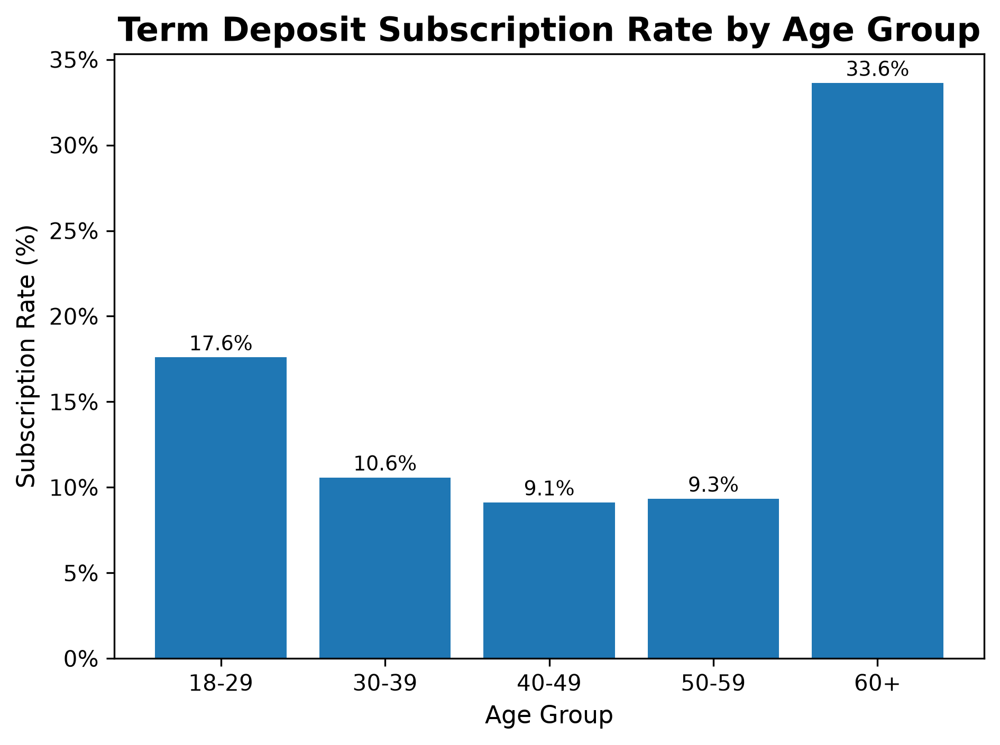
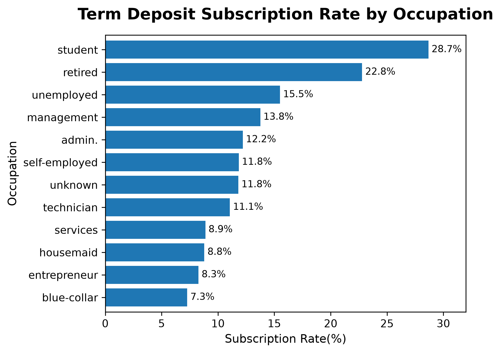
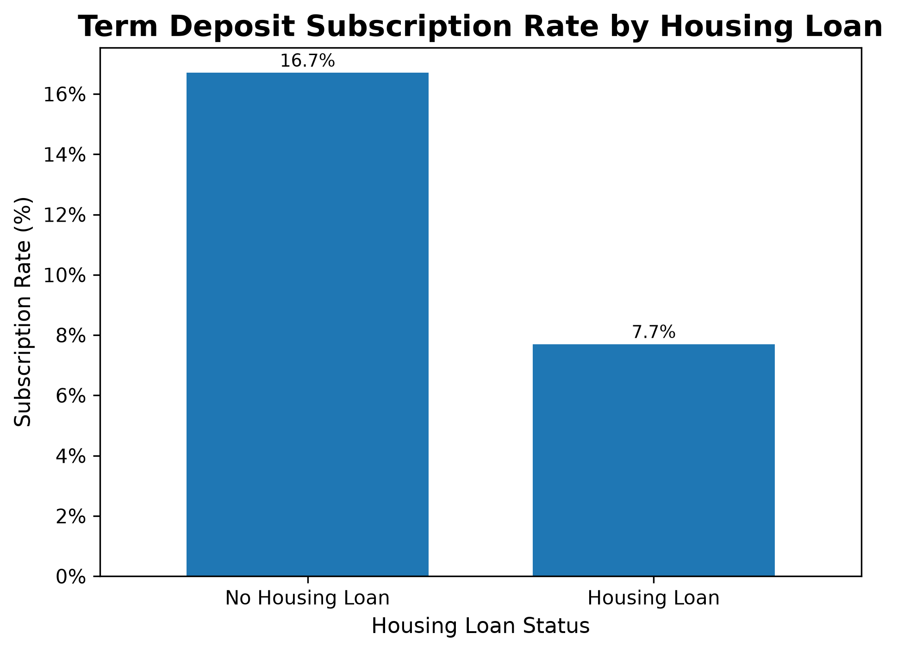
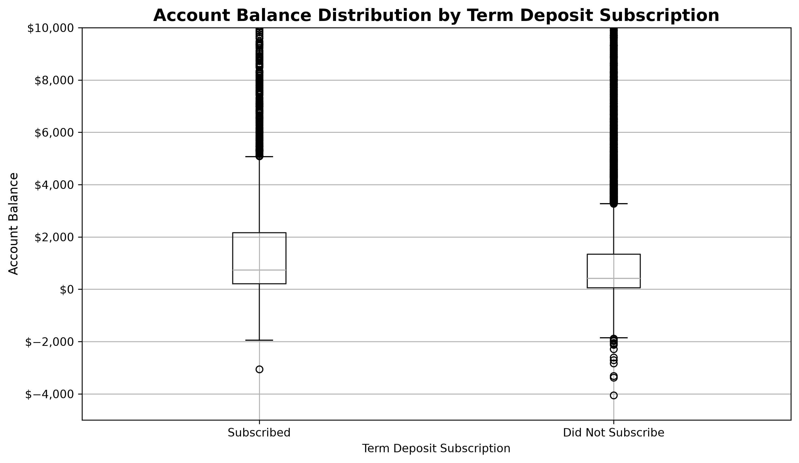

# Bank Marketing Analytics & Response Prediction

## Project Overview

Banks often use direct marketing campaigns to promote financial products such as term deposits. While these campaigns can reach thousands of customers, contacting every customer can be costly and inefficient.

The objective of this project is to analyze customer demographics, financial characteristics, and previous marketing interactions to identify patterns associated with successful term deposit subscriptions.

The project follows an end-to-end analytics workflow that progresses from exploratory analysis and customer segmentation to SQL analysis, statistical analysis, predictive modeling, and business recommendations.

---

## Data Source

This project uses the **Bank Marketing Dataset** from the UCI Machine Learning Repository. The dataset contains information from direct marketing campaigns conducted by a Portuguese banking institution, primarily through telephone contact.

The analysis uses the `bank-full.csv` dataset, containing **45,211 customer records** and information on customer demographics, financial characteristics, campaign interactions, previous campaign outcomes, and whether the customer subscribed to a term deposit.

**Source:** UCI Machine Learning Repository — Bank Marketing Dataset  
**Creators:** Sérgio Moro, Paulo Rita, and Paulo Cortez  
**DOI:** 10.24432/C5K306

---

## Business Problem

**How can the bank improve the efficiency of its direct marketing campaigns by identifying customer and campaign characteristics associated with higher term deposit subscription rates?**

The analysis focuses on translating customer and campaign data into insights that could support more informed customer targeting decisions.

---

## Dataset

The dataset contains more than 45,000 customer records and includes variables describing:

- Customer demographics
- Employment and education
- Account balances
- Credit default status
- Housing loan status
- Personal loan status
- Marketing contact methods
- Campaign contact frequency
- Previous marketing campaign outcomes
- Term deposit subscription status (`y`) as the target variable

---

## Tools & Technologies

### Currently Used

- Python
- pandas
- NumPy
- Matplotlib
- Jupyter Notebook
- Git
- GitHub

### Planned for Later Phases

- SQL
- Statistical Analysis
- Scikit-learn
- Power BI

---

# Project Workflow

## Phase 1 — Data Preparation ✅

Initial preparation and validation included:

- Imported the raw dataset
- Inspected dataset dimensions and structure
- Reviewed data types
- Examined missing and unknown values
- Validated important variables
- Reviewed the target variable
- Prepared the dataset for exploratory analysis

---

## Phase 2 — Exploratory Data Analysis ✅

The initial exploratory analysis examines the overall characteristics of the bank's customers and marketing activity.

### Customer Characteristics

Analysis includes:

- Age
- Occupation
- Marital status
- Education
- Credit default
- Housing loans
- Personal loans
- Account balances

### Marketing Campaign Characteristics

Analysis includes:

- Contact method
- Contact month
- Campaign activity
- Term deposit subscription outcome

The exploratory analysis establishes the overall structure and distribution of the data before comparing customer groups.

---

## Phase 3 — Comparative Customer Analysis ✅

The comparative analysis extends the initial exploratory analysis by examining differences in term deposit subscription behavior across customer and campaign characteristics.

The analysis examines:

- Overall term deposit subscription rate
- Subscription rates across occupations
- Subscription rates across age groups
- Account balance differences between subscribers and non-subscribers
- Housing loan status and subscription behavior
- Personal loan status and subscription behavior
- Contact method and subscription behavior
- Campaign contact frequency
- Previous campaign outcomes
- Multi-variable customer segmentation

The purpose of this phase is to move beyond simple distributions and identify customer segments and campaign characteristics associated with different response rates.

These findings are **descriptive rather than causal**. They identify patterns and relationships in historical campaign data but do not establish that any individual characteristic causes a customer to subscribe.

---

## Current Progress

| Phase | Status |
|---|:---:|
| Data Preparation | ✅ Complete |
| Exploratory Data Analysis | ✅ Complete |
| Comparative Customer Analysis | ✅ Complete |
| SQL Business Analysis | 🚧 Next |
| Statistical Analysis | ⏳ Planned |
| Predictive Modeling | ⏳ Planned |
| Model Evaluation | ⏳ Planned |
| Power BI Dashboard | ⏳ Planned |
| Business Recommendations | ⏳ Planned |

---

# Key Exploratory Findings

Initial exploratory analysis provides important context about the bank's customer population and campaign activity.

Some observations include:

- Most customers do not have a history of credit default.
- Housing loan ownership is relatively balanced across the customer base.
- Personal loans are less common among customers.
- Cellular phones are the primary contact method used during marketing campaigns.
- Marketing activity was heavily concentrated during certain months, particularly May.
- Term deposit subscriptions represent a minority of campaign outcomes, making response rate an important metric for later analysis.

These observations describe the historical dataset and provide context for deeper comparative and predictive analysis.

---

# Comparative Analysis

The comparative phase focuses on how subscription behavior differs across customer and campaign characteristics.

Examples of questions investigated include:

- Which occupations have higher or lower historical subscription rates?
- How does subscription behavior vary across age groups?
- Do subscribers and non-subscribers differ in their account balances?
- How does housing loan status relate to subscription rates?
- How does personal loan status relate to subscription rates?
- How do different contact methods compare?
- How does campaign contact frequency differ between outcomes?
- How does previous campaign performance relate to future subscription behavior?
- What additional patterns appear when multiple customer characteristics are considered together?

This analysis creates a foundation for the SQL and predictive modeling stages of the project.

---

# Example Visualizations

## Age Distribution


---

## Occupation Distribution


---

## Education Distribution


---

## Contact Method Distribution


---

## Customer Contacts by Month


---

## Subscription Rate by Age Group



---

## Subscription Rate by Occupation



---

## Subscription Rate by Housing Loan Status



---

## Account Balance by Subscription Outcome



---

# Skills Demonstrated

## Python & Data Analysis

- Data loading and inspection with pandas
- Data validation and preparation
- Exploratory data analysis
- Grouped aggregations
- Cross-tabulation
- Customer segmentation
- Comparative analysis
- Analysis of financial and campaign variables

## Data Visualization

- Matplotlib
- Distribution visualizations
- Segment comparisons
- Subscription-rate visualizations
- Business-focused chart interpretation

## Analytical Thinking

- Translating business questions into analytical questions
- Comparing customer segments
- Evaluating mean and median for financial variables
- Identifying target class imbalance
- Examining multiple variables together
- Distinguishing descriptive relationships from causal conclusions
- Translating analytical results into business context

## Version Control

- Git
- GitHub
- Incremental project development
- Organized repository structure
- Documentation of analytical progress

---

# Project Structure

```text
bank-marketing-analytics/

├── README.md
├── requirements.txt
│
├── data/
│   ├── raw/
│   └── processed/
│
├── docs/
│   ├── BUSINESS_QUESTIONS.md
│   └── ROADMAP.md
│
├── notebooks/
│   ├── 01_data_exploration.ipynb
│   └── 02_comparative_analysis.ipynb
│
├── plots/
│   ├── age_distribution.png
│   ├── job_distribution.png
│   ├── marital_distribution.png
│   ├── education_distribution.png
│   ├── default_distribution.png
│   ├── housing_distribution.png
│   ├── personal_loan_distribution.png
│   ├── contact_method_distribution.png
│   ├── month_distribution.png
│   ├── age_subscription_rate.png
│   ├── job_subscription_rate.png
│   ├── housing_subscription_rate.png
│   └── balanc_subscription_boxplot.png
│
├── sql/
├── models/
└── powerbi/