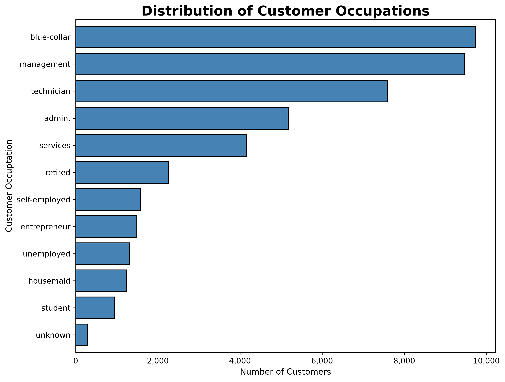
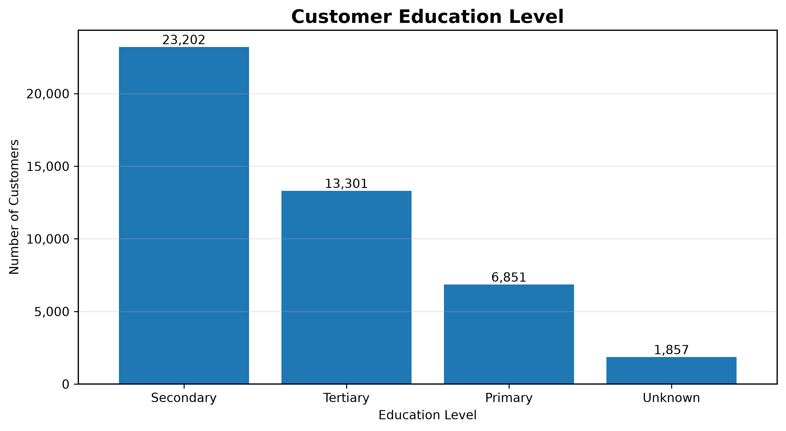
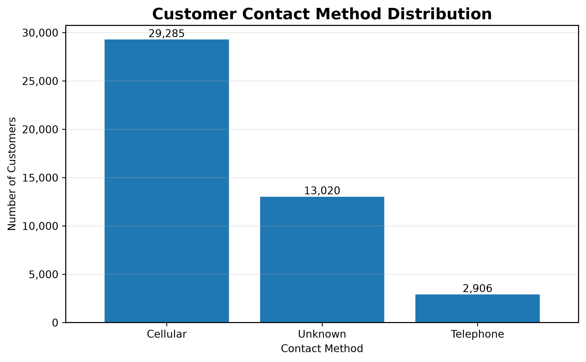
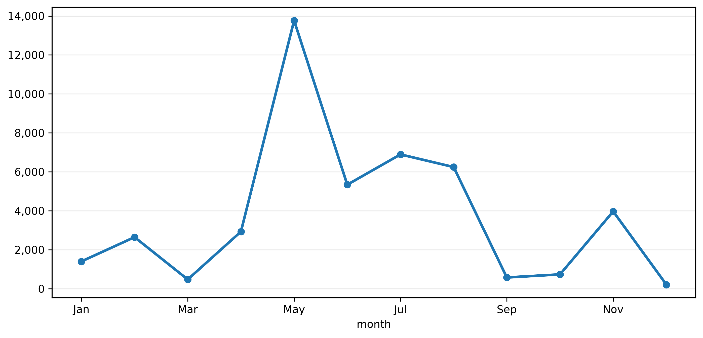

# Bank Marketing Campaign Analysis

## Project Overview

Banks often use direct marketing campaigns to promote financial products such as term deposits. While these campaigns can reach thousands of customers, contacting every customer is costly and inefficient.

The objective of this project is to analyze customer demographics, financial characteristics, and previous marketing interactions to identify factors associated with successful term deposit subscriptions. Insights from this analysis will be used to recommend more effective customer targeting strategies and build predictive models for future marketing campaigns.

---

## Business Problem

How can the bank improve the efficiency of its direct marketing campaign by identifying customers who are most likely to subscribe to a term deposit?

---

## Dataset

This project uses the **Bank Marketing Dataset**, which contains information on over 45,000 customers from a Portuguese banking institution.

The dataset includes:

- Customer demographics
- Financial characteristics
- Previous campaign history
- Contact information
- Marketing outcomes
- Term deposit subscription status (target variable)

---

## Tools & Technologies

- Python
- Pandas
- NumPy
- Matplotlib
- Jupyter Notebook
- Git
- GitHub

Future phases will also include:

- SQL
- Statistical Analysis
- Machine Learning (Scikit-learn)

---

# Project Workflow

## Phase 1 — Data Preparation ✔

- Imported dataset
- Inspected data structure
- Checked data types
- Examined missing values
- Performed initial data cleaning

---

## Phase 2 — Exploratory Data Analysis ✔

Completed analyses include:

### Customer Characteristics

- Age Distribution
- Occupation
- Marital Status
- Education
- Credit Default
- Housing Loan
- Personal Loan

### Marketing Campaign Variables

- Contact Method
- Contact Month

Each analysis includes:

- Variable description
- Business question
- Professional visualization
- Key findings
- Business interpretation

---

## Current Progress

| Phase | Status |
|---------|:------:|
| Data Cleaning | ✅ Complete |
| Exploratory Data Analysis | ✅ Complete |
| Comparative Analysis | 🚧 In Progress |
| SQL Analysis | ⏳ Planned |
| Statistical Analysis | ⏳ Planned |
| Predictive Modeling | ⏳ Planned |
| Business Recommendations | ⏳ Planned |

---

# Key Exploratory Findings

Some initial observations from the exploratory analysis include:

- Most customers do not have a history of credit default.
- Housing loan ownership is relatively balanced across the customer base.
- Personal loans are uncommon among customers.
- Cellular phones are the primary contact method used during marketing campaigns.
- Marketing activity was heavily concentrated during May and remained relatively high throughout the summer before declining later in the year.

These findings provide important context for later analyses but do not establish causal relationships with term deposit subscriptions.

---

# Example Visualizations

## Age Distribution


---

## Occupation Distribution



---

## Education Distribution



---

## Contact Method Distribution



---

## Customer Contacts by Month



---

# Project Structure

```
bank-marketing-analysis/

│── README.md
│── BUSINESS_QUESTIONS.md
│── requirements.txt

├── data/
│   └── bank.csv

├── notebooks/
│   ├── 01_exploratory_data_analysis.ipynb
│   ├── 02_comparative_analysis.ipynb
│   ├── 03_sql_analysis.ipynb
│   └── 04_predictive_model.ipynb

├── plots/
│   ├── age_distribution.png
│   ├── job_distribution.png
│   ├── marital_distribution.png
│   ├── education_distribution.png
│   ├── default_distribution.png
│   ├── housing_distribution.png
│   ├── personal_loan_distribution.png
│   ├── contact_method_distribution.png
│   └── month_distribution.png
```

---

# Future Work

The remaining phases of this project include:

### Comparative Exploratory Data Analysis

- Customer characteristics vs. subscription rate
- Marketing variables vs. subscription rate
- Conversion rate analysis

### SQL Analysis

- Business-focused SQL queries
- Window functions
- Common Table Expressions (CTEs)
- Views
- Ranking analyses

### Statistical Analysis

- Hypothesis testing
- Chi-square tests
- Correlation analysis
- Confidence intervals

### Predictive Modeling

- Logistic Regression
- Decision Tree
- Random Forest
- Model evaluation
- Feature importance analysis

### Business Recommendations

The project will conclude with actionable recommendations describing how the bank can improve future marketing campaigns by targeting customers more effectively.

---

## Author

**Abigail Calvert**

Data Science Student | Arizona State University

This project is part of my data science portfolio and demonstrates the complete analytics workflow from data exploration to predictive modeling.