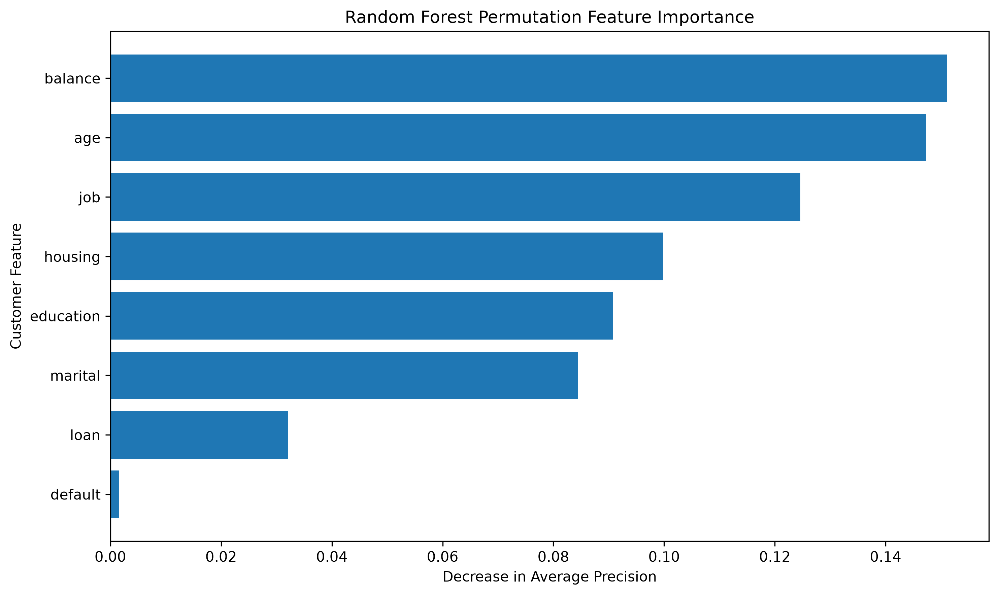

# Bank Marketing Analytics & Response Prediction

## Project Overview

Banks use direct marketing campaigns to promote financial products such as term deposits. However, contacting large numbers of customers can be costly and inefficient.

This project analyzes customer demographics, financial characteristics, and marketing campaign information to identify patterns associated with successful term deposit subscriptions.

The project demonstrates an end to end analytics workflow using Python, SQL, statistical hypothesis testing, machine learning, and data visualization.

**Project objective:** Identify customer characteristics associated with subscription outcomes, evaluate predictive classification models, and develop insights that could support more efficient marketing decisions within financial services.

---

## Data Source

This project uses the **Bank Marketing Dataset** from the UCI Machine Learning Repository.

The dataset contains information from direct marketing campaigns conducted by a Portuguese banking institution, primarily through telephone contact.

**Dataset:** `bank-full.csv`

**Customer records:** 45,211

**Variables:** 17

**Target variable:** `y`, indicating whether a customer subscribed to a term deposit.

**Source:** [UCI Machine Learning Repository](https://archive.ics.uci.edu/dataset/222/bank+marketing)

**Creators:** Sérgio Moro, Paulo Rita, and Paulo Cortez

**DOI:** 10.24432/C5K306

---

## Business Problem

**How can a bank improve direct marketing efficiency by identifying customers who are more likely to subscribe to a term deposit?**

The project investigates:

1. Which customer characteristics are associated with successful subscriptions?
2. How do housing loans, personal loans, and account balances relate to subscription behavior?
3. How does marketing contact frequency relate to subscription outcomes?
4. Which customer segments demonstrate higher historical response rates?
5. Are selected relationships statistically significant?
6. Can machine learning predict subscription outcomes using information available before marketing contact?
7. Which predictive model provides the strongest performance for identifying potential subscribers?

The ultimate goal is to translate analytical findings into business recommendations that support customer segmentation and marketing decisions.

---

## Tools & Technologies

### Programming and Data Analysis

- Python
- pandas
- NumPy
- Matplotlib
- SciPy
- statsmodels
- Jupyter Notebook

### SQL and Database Analysis

- SQL
- SQLite

### Machine Learning

- scikit-learn
- Logistic Regression
- Random Forest Classification
- Classification Pipelines
- StandardScaler
- OneHotEncoder
- Class Imbalance Handling
- Precision, Recall, and F1 Score
- ROC AUC
- Average Precision
- Precision Recall Curves
- Confusion Matrices
- Permutation Feature Importance

### Development and Version Control

- Visual Studio Code
- Git
- GitHub

### Planned

- Power BI

---

# Project Workflow

## Phase 1: Data Preparation ✅

Initial data preparation focused on understanding and validating the dataset.

Tasks completed:

- Imported the dataset using pandas
- Inspected dataset dimensions and structure
- Reviewed column data types
- Examined missing and unknown values
- Validated important variables
- Reviewed subscription outcomes
- Prepared data for exploratory analysis

The dataset contains **45,211 customer records and 17 variables**.

## Phase 2: Exploratory Data Analysis ✅

Exploratory analysis examined the distributions of customer demographics, financial characteristics, and marketing campaign variables.

### Customer Characteristics

- Age
- Occupation
- Marital status
- Education
- Credit default status
- Housing loan status
- Personal loan status
- Account balances

### Marketing Characteristics

- Contact method
- Contact month
- Campaign activity
- Subscription outcome

Visualizations were created using Matplotlib to examine distributions and identify patterns.

**Notebook:** [Data Exploration](notebooks/01_data_exploration.ipynb)

## Phase 3: Comparative Customer Analysis ✅

Comparative analysis investigated differences in subscription behavior across customer groups.

Analyses included:

- Overall subscription rate
- Subscription rates by occupation
- Subscription rates by age group
- Account balance comparisons
- Housing loan status and subscription behavior
- Personal loan status and subscription behavior
- Contact method comparisons
- Campaign contact frequency
- Previous campaign outcomes
- Multivariable customer segmentation

This phase extended exploratory analysis by identifying groups with different historical subscription rates.

The findings are descriptive and do not establish causal relationships.

**Notebook:** [Comparative Customer Analysis](notebooks/02_comparative_analysis.ipynb)

## Phase 4: SQL Business Analysis ✅

SQL was used to analyze customer characteristics, financial obligations, and marketing performance using SQLite.

The analysis used the `bank_marketing` table containing 45,211 customer records.

### SQL Analysis Completed

**1. Data Validation and Campaign Performance**

- Verified customer record counts
- Calculated successful and unsuccessful subscriptions
- Calculated the overall subscription rate

**2. Customer Segmentation**

- Compared subscription rates across occupations
- Ranked occupational groups by subscription performance
- Analyzed customer characteristics associated with different response rates

**3. Financial Characteristics**

- Compared housing loan and personal loan groups
- Analyzed account balances
- Created balance based customer segments

**4. Marketing Campaign Performance**

- Compared contact methods
- Calculated average campaign contact frequency
- Grouped customers by number of contacts
- Compared subscription rates across contact frequency categories

**5. Multivariable Analysis**

- Compared occupation and housing loan status
- Examined subscription rates within customer subgroups
- Used conditional aggregation to calculate performance metrics

### SQL Techniques Demonstrated

- `SELECT`, `WHERE`, `GROUP BY`, and `ORDER BY`
- `COUNT()`, `SUM()`, `AVG()`, and `ROUND()`
- `CASE WHEN`
- Conditional aggregation
- Common Table Expressions using `WITH`
- Window functions using `RANK() OVER`
- Customer segmentation
- Calculated business metrics
- Multivariable comparisons

**SQL File:** [Customer and Campaign Analysis](sql/01_customer_campaign_analysis.sql)

## Phase 5: Statistical Analysis ✅

Statistical analysis evaluated whether selected customer characteristics and financial variables were associated with term deposit subscription outcomes.

The analysis included chi square tests of independence, confidence intervals, and a Mann Whitney U test.

### Housing Loan Status

Historical subscription rates differed substantially by housing loan status.

| Housing Loan Status | Subscription Rate |
|---|---:|
| No housing loan | 16.70% |
| Housing loan | 7.70% |

Customers without housing loans demonstrated higher historical subscription rates.

A chi square test was used to investigate the relationship between housing loan status and subscription outcome.

### Personal Loan Status

A chi square test examined the association between personal loan status and subscription outcome.

**Results:**

- Chi square statistic: 209.62
- P value: approximately 1.67 × 10⁻⁴⁷
- Degrees of freedom: 1

| Personal Loan Status | Subscription Rate |
|---|---:|
| No personal loan | 12.66% |
| Personal loan | 6.68% |

The test provided strong statistical evidence of an association between personal loan status and subscription outcome.

### Confidence Interval Analysis

A 95% Wilson confidence interval was calculated for the subscription rate among customers without personal loans.

**Results:**

- Customers without personal loans: 37,967
- Successful subscriptions: 4,805
- Observed subscription rate: 12.66%
- 95% confidence interval: approximately 12.33% to 12.99%

### Account Balance Comparison

A two sided Mann Whitney U test compared account balance distributions between subscribers and nonsubscribers.

| Statistic | Result |
|---|---:|
| Median balance among subscribers | €733 |
| Median balance among nonsubscribers | €417 |
| Difference in medians | €316 |
| Mann Whitney U statistic | 124,589,983.5 |
| P value | Approximately 6.59 × 10⁻¹⁰¹ |

The test provided strong statistical evidence that the account balance distributions differed between subscribers and nonsubscribers.

### Statistical Analysis Conclusions

The statistical analysis supports further investigation of loan status and account balance as potential predictors of subscription outcomes.

Important considerations:

- Statistical significance does not establish causation.
- Large datasets can produce very small p values even when practical effects are limited.
- Historical associations may not generalize to future campaigns.
- Predictive usefulness must be evaluated using unseen data.

**Notebook:** [Statistical Analysis](notebooks/03_statistical_analysis.ipynb)

## Phase 6: Predictive Modeling and Model Evaluation ✅

Three machine learning classification models were developed to predict whether a customer would subscribe to a term deposit.

The modeling workflow focused on using customer information available before marketing contact, handling class imbalance, and evaluating performance on unseen data.

### Data Preparation and Feature Selection

Eight customer features were selected:

| Feature | Description |
|---|---|
| Age | Customer age |
| Job | Occupation category |
| Marital | Marital status |
| Education | Education level |
| Default | Credit default status |
| Balance | Account balance |
| Housing | Housing loan status |
| Loan | Personal loan status |

The target variable was converted into binary values:

- `0`: Customer did not subscribe
- `1`: Customer subscribed

**Data leakage prevention:** Call duration was excluded because it is not available before a marketing call. The models were designed around information that could be used for customer targeting before contact.

### Training and Testing Data

The dataset was divided using a stratified training and testing split.

| Dataset | Records |
|---|---:|
| Training | 36,168 |
| Testing | 9,043 |
| Total | 45,211 |

The training and testing sets maintained approximately the same subscription rate of 11.70%.

### Preprocessing

A scikit-learn `ColumnTransformer` was used to prepare the selected features.

Numerical features:

- Age
- Balance

These variables were processed using `StandardScaler`.

Categorical features:

- Job
- Marital status
- Education
- Default status
- Housing loan status
- Personal loan status

These variables were processed using `OneHotEncoder`.

Preprocessing and classification were combined into scikit-learn pipelines to ensure consistent transformations during training and prediction.

### Models Developed

**1. Original Logistic Regression**

A logistic regression classifier was trained as an initial benchmark.

**2. Balanced Logistic Regression**

A second logistic regression model used `class_weight="balanced"` to account for the lower frequency of successful subscriptions.

**3. Random Forest**

A Random Forest classifier was trained using 100 decision trees and balanced class weights.

### Model Comparison

The three models were evaluated using accuracy, precision, recall, F1 score, ROC AUC, and Average Precision.

| Model | Accuracy | Precision | Recall | F1 Score | ROC AUC | Average Precision |
|---|---:|---:|---:|---:|---:|---:|
| Original Logistic Regression | 0.883 | 0.000 | 0.000 | 0.000 | 0.666 | 0.213 |
| Balanced Logistic Regression | 0.622 | 0.180 | 0.627 | 0.280 | 0.666 | 0.211 |
| Random Forest | 0.825 | 0.299 | 0.370 | 0.330 | 0.688 | 0.316 |

### Model Evaluation Findings

**Original Logistic Regression**

The original logistic regression model achieved approximately 88.3% accuracy but failed to correctly identify any actual subscribers at the default classification threshold.

This demonstrates why accuracy alone can be misleading when evaluating imbalanced datasets.

**Balanced Logistic Regression**

Balanced logistic regression achieved approximately 62.7% recall, identifying a substantially greater proportion of actual subscribers.

However, precision was only 18.0%, meaning many customers predicted to subscribe did not actually subscribe.

This model may be useful when maximizing subscriber identification is more important than minimizing unsuccessful outreach.

**Random Forest**

Random Forest achieved the strongest overall performance across several important evaluation metrics.

Key results:

- Accuracy: 82.5%
- Precision: 29.9%
- Recall: 37.0%
- F1 score: 33.0%
- ROC AUC: 0.688
- Average Precision: 0.316

Random Forest demonstrated the highest F1 score, ROC AUC, and Average Precision among the three models.

### Class Imbalance and Evaluation Strategy

Only approximately 11.70% of customers subscribed to a term deposit.

Because of this class imbalance, the modeling analysis emphasized metrics beyond accuracy.

**Precision** measures how many customers predicted to subscribe actually subscribed.

**Recall** measures how many actual subscribers were successfully identified.

**F1 score** balances precision and recall.

**ROC AUC** measures how effectively a model ranks subscribers above nonsubscribers.

**Average Precision** summarizes precision recall performance across classification thresholds and is particularly useful when the positive class is relatively uncommon.

Precision recall curves were also created to compare the models.

### Random Forest Feature Importance

Permutation importance was calculated using Average Precision as the scoring metric.

The analysis measured how much model performance decreased when individual features were randomly shuffled.

| Feature | Permutation Importance |
|---|---:|
| Balance | 0.1511 |
| Age | 0.1473 |
| Job | 0.1246 |
| Housing | 0.0998 |
| Education | 0.0907 |
| Marital | 0.0844 |
| Loan | 0.0321 |
| Default | 0.0015 |

Account balance, age, and occupation were the most influential features in the Random Forest model.

Housing loan status, education, and marital status also contributed to predictive performance.

Credit default status demonstrated relatively little predictive importance in this model.

These values represent changes in model performance when features are shuffled, not causal effects or percentage contributions.

### Predictive Modeling Conclusion

**Random Forest was selected as the strongest candidate for further development** because it achieved the highest Average Precision, ROC AUC, and F1 score among the evaluated models.

However, balanced logistic regression achieved higher recall and may be preferable in scenarios where identifying more potential subscribers is the primary objective.

The final model choice should depend on the bank's marketing costs, expected subscription value, and desired balance between precision and recall.

The results demonstrate potential for customer prioritization but are not sufficient to justify production deployment without additional validation.

**Notebook:** [Predictive Modeling](notebooks/04_predictive_modeling.ipynb)

---

## Current Progress

| Phase | Status |
|---|---|
| Data Preparation | ✅ Complete |
| Exploratory Data Analysis | ✅ Complete |
| Comparative Customer Analysis | ✅ Complete |
| SQL Business Analysis | ✅ Complete |
| Statistical Analysis | ✅ Complete |
| Predictive Modeling | ✅ Complete |
| Model Evaluation | ✅ Complete |
| Power BI Dashboard | Planned |
| Final Business Recommendations | In Progress |

---

# Key Analytical Findings

## 1. Overall Campaign Performance

The dataset contains **45,211 customer records**.

| Metric | Result |
|---|---:|
| Total customers | 45,211 |
| Successful subscriptions | 5,289 |
| Unsuccessful subscriptions | 39,922 |
| Overall subscription rate | 11.70% |

The relatively low positive response rate highlights the importance of customer segmentation and class imbalance considerations for predictive modeling.

## 2. Housing Loan Status

Customers without housing loans demonstrated higher subscription rates.

| Housing Loan Status | Customers | Subscription Rate |
|---|---:|---:|
| No | 20,081 | 16.70% |
| Yes | 25,130 | 7.70% |

Housing loan status may be a useful segmentation variable.

## 3. Personal Loan Status

Customers without personal loans demonstrated higher subscription rates.

| Personal Loan Status | Customers | Subscription Rate |
|---|---:|---:|
| No | 37,967 | 12.66% |
| Yes | 7,244 | 6.68% |

Statistical testing found strong evidence of an association between personal loan status and subscription outcome.

## 4. Contact Method Performance

Historical subscription rates differed across contact methods.

| Contact Method | Customers | Subscription Rate |
|---|---:|---:|
| Cellular | 29,285 | 14.92% |
| Telephone | 2,906 | 13.42% |
| Unknown | 13,020 | 4.07% |

Cellular contacts were associated with the highest observed subscription rate.

However, the results do not establish that the contact method itself caused higher subscription rates.

## 5. Campaign Contact Frequency

Subscription rates varied depending on the number of contacts during a campaign.

| Number of Contacts | Customers | Subscription Rate |
|---|---:|---:|
| 1 contact | 17,544 | 14.60% |
| 2 contacts | 12,505 | 11.20% |
| 3 contacts | 5,521 | 11.19% |
| 4 or more contacts | 9,641 | 7.35% |

Customers contacted once demonstrated the highest observed subscription rate.

These findings do not establish that additional contacts cause lower subscription rates.

## 6. Customer Balance Segmentation

Customers were grouped into account balance categories.

| Balance Segment | Customers | Subscription Rate |
|---|---:|---:|
| High | 2,845 | 15.50% |
| Medium | 11,786 | 15.33% |
| Low | 23,300 | 10.90% |
| Negative or Zero | 7,280 | 6.90% |

Customers in higher balance segments demonstrated higher historical subscription rates.

## 7. Occupational Differences

Subscription rates varied across occupational categories.

| Occupation | Subscription Rate |
|---|---:|
| Student | 28.68% |
| Retired | 22.79% |
| Management | 13.76% |
| Technician | 11.06% |
| Blue collar | 7.27% |

Students and retired customers demonstrated relatively high historical subscription rates.

Occupational categories vary in size, so these percentages should be interpreted alongside customer counts.

## 8. Predictive Model Performance

Random Forest demonstrated the strongest overall predictive performance among the three models evaluated.

Its Average Precision of 0.316 exceeded the original logistic regression score of 0.213 and the balanced logistic regression score of 0.211.

Balanced logistic regression achieved higher recall, demonstrating the tradeoff between identifying more potential subscribers and avoiding unsuccessful outreach.

## 9. Most Important Predictive Features

Random Forest permutation importance identified the following features as the strongest contributors to predictive performance:

1. Account balance
2. Age
3. Occupation
4. Housing loan status
5. Education

These results support further investigation of customer financial characteristics and demographics for marketing prioritization.

---

# Business Interpretation and Recommendations

The combined descriptive, statistical, and predictive analyses suggest several opportunities for improving marketing decision making.

### Customer Segmentation

Historical subscription rates differed across customer groups, particularly by loan status, account balance, and occupation.

These differences may help identify customer segments for further investigation.

### Predictive Customer Prioritization

Random Forest demonstrated useful predictive discrimination and may provide a starting point for ranking customers by estimated subscription likelihood.

A probability based prioritization strategy could be evaluated against broad customer outreach.

### Marketing Efficiency

The bank should consider the tradeoff between contacting more potential subscribers and limiting outreach to customers less likely to respond.

Probability thresholds should be selected using marketing costs, campaign capacity, and expected subscription value rather than relying only on default classification thresholds.

### Further Validation

Before operational use, the models should be evaluated using more recent customer data and additional validation procedures.

Predictive associations do not demonstrate that targeting particular customer groups will cause subscription rates to increase.

---

# Next Phase: Power BI Dashboard

The next phase will focus on creating an interactive business intelligence dashboard to communicate the analytical findings.

### Planned Dashboard Components

1. Overall campaign performance and subscription rates
2. Customer demographics and financial characteristics
3. Subscription rates across customer segments
4. Housing loan and personal loan comparisons
5. Account balance analysis
6. Marketing contact frequency and response patterns
7. Predictive model performance comparison
8. Business insights and recommendations

The dashboard will help translate the technical analysis into accessible information for business stakeholders.

---

# Example Visualizations

## Age Distribution


## Occupation Distribution


## Education Distribution


## Contact Method Distribution


## Customer Contacts by Month


## Subscription Rate by Age Group


## Subscription Rate by Occupation


## Subscription Rate by Housing Loan Status


## Account Balance by Subscription Outcome


## Subscription Rates by Loan Status


## Random Forest Feature Importance



---

# Skills Demonstrated

## Python and Data Analysis

- Data loading and inspection with pandas
- Data validation and preparation
- Exploratory data analysis
- Grouped aggregations
- Cross tabulation
- Customer segmentation
- Comparative analysis
- Analysis of financial and campaign variables

## SQL and Database Analysis

- Querying relational data with SQLite
- Aggregation and grouping
- Conditional aggregation
- Calculated performance metrics
- Common Table Expressions
- Window functions
- Customer ranking
- Multivariable segmentation
- Translating business questions into SQL queries

## Statistical Analysis

- Chi square tests of independence
- Hypothesis testing
- Contingency tables
- Statistical significance
- Wilson confidence intervals
- Mann Whitney U test
- Comparison of financial distributions
- Interpretation of statistical uncertainty
- Distinguishing statistical significance from causation

## Machine Learning

- Classification modeling with scikit-learn
- Logistic Regression
- Random Forest Classification
- Stratified training and testing splits
- Numerical feature scaling
- Categorical feature encoding
- ColumnTransformer
- Machine learning pipelines
- Class imbalance handling
- Accuracy, precision, recall, and F1 evaluation
- ROC AUC and Average Precision
- Confusion matrix interpretation
- Precision recall curve analysis
- Permutation feature importance
- Model comparison and selection
- Data leakage prevention

## Data Visualization

- Matplotlib
- Distribution visualizations
- Segment comparisons
- Subscription rate visualizations
- Confusion matrix visualizations
- Precision recall curves
- Feature importance charts
- Business focused chart interpretation

## Analytical Thinking

- Translating business problems into analytical questions
- Comparing customer segments
- Evaluating mean and median for financial variables
- Identifying target class imbalance
- Examining multiple variables together
- Interpreting statistical test results
- Evaluating predictive model tradeoffs
- Distinguishing association from causation
- Translating analytical findings into business context

## Version Control and Documentation

- Git
- GitHub
- Incremental project development
- Organized repository structure
- SQL script documentation
- Jupyter notebook documentation
- Documentation of analytical findings and progress

---

# Project Structure

```text
bank-marketing-analytics/
│
├── README.md
├── requirements.txt
├── .gitignore
│
├── data/
│   ├── raw/
│   └── processed/
│
├── docs/
│   ├── BUSINESS_QUESTIONS.md
│   └── ROADMAP.md
│
├── notebooks/
│   ├── 01_data_exploration.ipynb
│   ├── 02_comparative_analysis.ipynb
│   ├── 03_statistical_analysis.ipynb
│   └── 04_predictive_modeling.ipynb
│
├── plots/
│   ├── age_distribution.png
│   ├── job_distribution.png
│   ├── marital_distribution.png
│   ├── education_distribution.png
│   ├── default_distribution.png
│   ├── housing_distribution.png
│   ├── loan_distribution.png
│   ├── contact_method_distribution.png
│   ├── month_distribution.png
│   ├── age_subscription_rate.png
│   ├── job_subscription_rate.png
│   ├── housing_subscription_rate.png
│   ├── balanc_subscription_boxplot.png
│   ├── loan_status_subscription_rates.png
│   └── random_forest_feature_importance.png
│
├── sql/
│   └── 01_customer_campaign_analysis.sql
│
├── models/
│
└── powerbi/
```

The repository will continue to expand as dashboard development and final business recommendations are completed.

---

# Project Goals

By completion, this project aims to demonstrate the ability to:

1. Work with a real world financial services dataset.
2. Prepare, validate, and analyze structured customer data.
3. Use Python and SQL to answer business questions.
4. Identify meaningful customer segments and campaign performance patterns.
5. Apply statistical analysis and predictive classification techniques.
6. Evaluate machine learning models using appropriate performance metrics.
7. Communicate findings through visualizations and an interactive dashboard.
8. Translate analytical results into actionable business recommendations.

The project demonstrates an analytics workflow relevant to financial services, customer analytics, and data driven business decision making.