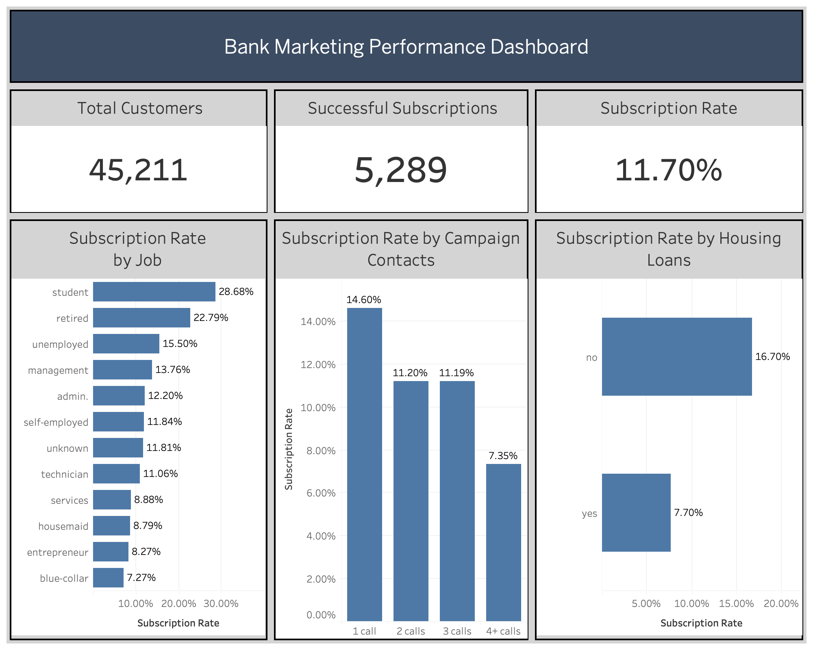

# Bank Marketing Analytics & Response Prediction

**An end to end banking analytics and machine learning project focused on understanding customer subscription behavior and evaluating opportunities to improve marketing campaign efficiency.**

This project analyzes 45,211 historical bank marketing records using **Python, SQL, statistical analysis, machine learning, and Tableau**. It investigates which customer characteristics are associated with term deposit subscriptions, evaluates predictive models using information available before customer contact, and proposes a practical business strategy for improving marketing resource allocation.

The project goes beyond technical analysis by connecting analytical findings to business recommendations, implementation considerations, and measurable performance indicators.

## Project Highlights

| Metric | Result |
|---|---|
| Historical Campaign Records | 45,211 |
| Successful Term Deposit Subscriptions | 5,289 |
| Overall Subscription Rate | 11.70% |
| Classification Models Evaluated | 3 |
| Best Model in Comparison | Random Forest |
| Random Forest ROC AUC | 0.688 |
| Random Forest F1 Score | 0.330 |
| Random Forest Average Precision | 0.316 |
| Business Deliverables | Tableau Dashboard and Business Solution |

## Business Problem

Banks invest significant time and resources in direct marketing campaigns, yet only a portion of contacted customers subscribe to financial products.

In this dataset, approximately 11.7% of campaign records resulted in a term deposit subscription.

This creates an opportunity to investigate whether customer analytics and predictive modeling could help financial institutions make more informed decisions about campaign planning and customer outreach.

**Central business question:**

How can a bank use historical customer information and predictive analytics to evaluate opportunities for more efficient term deposit marketing?

### Project Objectives

1. Understand historical customer subscription patterns.
2. Identify customer segments associated with different response rates.
3. Evaluate statistical relationships between financial characteristics and subscription outcomes.
4. Develop and compare predictive classification models.
5. Communicate findings through an interactive Tableau dashboard.
6. Propose a measurable business solution that could be evaluated before operational implementation.

## Business Solution

The proposed solution is a **data informed customer prioritization framework** that combines historical segmentation, predictive subscription probabilities, and campaign cost evaluation.

Rather than assuming all customers have the same likelihood of subscribing, the bank could investigate whether predictive models improve its ability to prioritize outreach.

The recommended approach includes:

1. Analyze historical customer segments and campaign performance.
2. Estimate subscription probabilities using information available before marketing contact.
3. Evaluate customer ranking and outreach strategies against an existing baseline.
4. Incorporate contact costs and expected contribution per subscription.
5. Test the proposed strategy through a controlled pilot.
6. Monitor actual incremental conversions, campaign efficiency, and model performance.

**Important:** This is a proposed business solution, not a deployed system. The project does not claim realized revenue growth, cost savings, or improved conversion rates.

**[Read the Complete Business Solution](docs/BUSINESS_SOLUTION.md)**

## Dataset

**Source:** UCI Machine Learning Repository, Bank Marketing Dataset

[Access the original dataset](https://archive.ics.uci.edu/dataset/222/bank+marketing)

The dataset contains historical direct marketing campaign information from a Portuguese banking institution.

| Dataset Characteristic | Description |
|---|---|
| Records | 45,211 |
| Original Variables | 17 |
| Target Variable | `y` |
| Positive Outcome | Customer subscribed to a term deposit |
| Negative Outcome | Customer did not subscribe |
| Successful Subscriptions | 5,289 |
| Overall Positive Rate | 11.70% |

The records represent historical campaign observations and should not automatically be interpreted as 45,211 unique individuals.

## Analytical Workflow

| Phase | Description | Status |
|---|---|---|
| Data Exploration | Data quality assessment, distributions, and customer characteristics | Complete |
| Comparative Analysis | Subscription rate comparisons across customer segments | Complete |
| SQL Analysis | Customer segmentation and campaign performance queries | Complete |
| Statistical Analysis | Hypothesis testing, confidence intervals, and distribution comparisons | Complete |
| Predictive Modeling | Logistic Regression, Balanced Logistic Regression, and Random Forest | Complete |
| Model Evaluation | Classification metrics and interpretation | Complete |
| Tableau Dashboard | Interactive visualization of campaign performance | Complete |
| Business Solution | Customer prioritization proposal and business evaluation framework | Complete |
| Documentation | Project findings, business questions, and roadmap | Complete |

## Key Analytical Findings

### 1. Housing Loan Status

| Housing Loan Status | Records | Subscription Rate |
|---|---:|---:|
| No Housing Loan | 20,081 | 16.70% |
| Has Housing Loan | 25,130 | 7.70% |

Customers without housing loans had substantially higher observed subscription rates.

**Business interpretation:** Housing loan status may help explain historical response differences and contribute useful information to predictive analysis.

### 2. Personal Loan Status

| Personal Loan Status | Records | Subscription Rate |
|---|---:|---:|
| No Personal Loan | 37,967 | 12.66% |
| Has Personal Loan | 7,244 | 6.68% |

Customers without personal loans had higher historical subscription rates.

Statistical analysis also identified a significant association between personal loan status and subscription outcome.

### 3. Account Balance

| Balance Segment | Records | Subscription Rate |
|---|---:|---:|
| High | 2,845 | 15.50% |
| Medium | 11,786 | 15.33% |
| Low | 23,300 | 10.90% |
| Negative or Zero | 7,280 | 6.90% |

Higher balance segments had higher observed subscription rates.

Median account balances also differed:

| Customer Group | Median Balance |
|---|---:|
| Subscribers | €733 |
| Non Subscribers | €417 |

These findings suggest that account balance is associated with historical subscription behavior.

### 4. Occupation

Selected historical subscription rates:

| Occupation | Subscription Rate |
|---|---:|
| Student | 28.68% |
| Retired | 22.79% |
| Management | 13.76% |
| Technician | 11.06% |
| Blue Collar | 7.27% |

Students and retired customers had relatively high historical response rates, while blue collar workers had a lower observed response rate.

These differences are descriptive and should not be treated as automatic customer targeting rules.

### 5. Campaign Contact Frequency

| Contacts During Campaign | Records | Subscription Rate |
|---|---:|---:|
| 1 | 17,544 | 14.60% |
| 2 | 12,505 | 11.20% |
| 3 | 5,521 | 11.19% |
| 4 or More | 9,641 | 7.35% |

Customers contacted once had the highest observed subscription rate.

However, repeated contacts may occur because customers have not yet subscribed. The data does not establish that additional contacts cause lower response rates.

### 6. Contact Method

| Contact Method | Records | Subscription Rate |
|---|---:|---:|
| Cellular | 29,285 | 14.92% |
| Telephone | 2,906 | 13.42% |
| Unknown | 13,020 | 4.07% |

Contact method was associated with different historical subscription rates.

Additional analysis would be necessary to determine whether changing contact methods could improve outcomes.

## Statistical Analysis

Statistical testing was used to evaluate selected relationships identified during exploratory analysis.

Methods included:

* Chi square tests for associations between categorical variables and subscription outcomes.
* Mann Whitney U testing for account balance distributions.
* Wilson confidence intervals for subscription proportions.

### Selected Statistical Results

| Analysis | Result |
|---|---|
| Personal Loan Association | Chi Square Statistic: 209.62 |
| Personal Loan Test | p value approximately 1.67 × 10⁻⁴⁷ |
| Median Balance for Subscribers | €733 |
| Median Balance for Non Subscribers | €417 |
| Balance Distribution Comparison | Mann Whitney U p value approximately 6.59 × 10⁻¹⁰¹ |

These tests provide evidence of historical statistical relationships.

**Statistical significance does not establish causation or guarantee business value.**

[View Statistical Analysis Notebook](notebooks/03_statistical_analysis.ipynb)

## Predictive Modeling

### Modeling Objective

Develop classification models to estimate whether a customer will subscribe to a term deposit using customer characteristics available before marketing contact.

The dataset has an imbalanced target, with approximately 11.7% positive outcomes.

### Features Used

Eight customer characteristics were selected:

1. Age
2. Account Balance
3. Occupation
4. Marital Status
5. Education
6. Credit Default Status
7. Housing Loan Status
8. Personal Loan Status

**Call duration was intentionally excluded** because it would not be available before the customer interaction.

The modeling approach focuses on precontact prediction rather than using information generated during the marketing campaign.

### Models Evaluated

| Model | Purpose |
|---|---|
| Logistic Regression | Establish an interpretable baseline |
| Balanced Logistic Regression | Examine an approach to class imbalance |
| Random Forest | Model potentially nonlinear relationships |

### Selected Random Forest Performance

| Evaluation Metric | Result |
|---|---:|
| F1 Score | 0.330 |
| ROC AUC | 0.688 |
| Average Precision | 0.316 |

The Random Forest performed best in the completed comparison.

Its results indicate some ability to distinguish between subscribers and nonsubscribers, but also demonstrate meaningful limitations.

### Model Interpretation

The project evaluates whether basic precontact customer information contains useful predictive signals.

Before considering operational use, additional work would be necessary to assess:

* Probability calibration.
* Classification thresholds.
* Precision within prioritized customer groups.
* Financial costs and expected benefits.
* Model stability on future campaigns.
* Fairness and responsible use of customer characteristics.

**The model is an experimental baseline, not a production ready customer targeting system.**

[View Predictive Modeling Notebook](notebooks/04_predictive_modeling.ipynb)

## Tableau Dashboard

The **Bank Marketing Performance Dashboard** provides an interactive summary of historical campaign performance.

### Dashboard Components

**Key Performance Indicators**

* 45,211 historical campaign records
* 5,289 successful subscriptions
* 11.70% overall subscription rate

**Interactive Visualizations**

* Subscription Rate by Job
* Subscription Rate by Campaign Contacts
* Subscription Rate by Housing Loans

The dashboard supports interactive filtering to explore customer segments and compare historical subscription outcomes.

### Dashboard Preview



**[Open Interactive Tableau Workbook](tableau/bank-marketing-analysis.twbx)**

The dashboard is intended for descriptive analytics. It does not display individual model predictions.

## SQL Analysis

SQL was used to answer business questions involving customer segmentation and campaign performance.

The SQL analysis includes:

* Customer and subscription counts.
* Conditional aggregations.
* Subscription rate calculations.
* Customer segment comparisons.
* Campaign performance analysis.
* Common Table Expressions.

The SQL component demonstrates how business questions can be translated into reproducible database queries.

[View SQL Analysis](sql/01_customer_campaign_analysis.sql)

## Repository Structure

```text
bank-marketing-analytics/
│
├── README.md
├── requirements.txt
│
├── data/
│   └── bank-full.csv
│
├── notebooks/
│   ├── 01_data_exploration.ipynb
│   ├── 02_comparative_analysis.ipynb
│   ├── 03_statistical_analysis.ipynb
│   └── 04_predictive_modeling.ipynb
│
├── sql/
│   └── 01_customer_campaign_analysis.sql
│
├── plots/
│   └── Generated analysis visualizations
│
├── tableau/
│   ├── bank-marketing-analysis.twbx
│   └── bank_marketing_dashboard.png
│
└── docs/
    ├── BUSINESS_QUESTIONS.md
    ├── BUSINESS_SOLUTION.md
    └── ROADMAP.md
```

## Business Questions

The project investigates:

1. What is the overall term deposit subscription rate?
2. How does housing loan status relate to subscription outcomes?
3. How does personal loan status relate to subscription outcomes?
4. How does contact method relate to historical campaign performance?
5. How does campaign contact frequency relate to subscription rates?
6. How does account balance relate to subscription behavior?
7. Which occupational groups have higher historical response rates?
8. Are selected relationships statistically significant?
9. Can machine learning estimate subscription outcomes before marketing contact?
10. How can campaign performance be communicated to business stakeholders?

**[Read the Business Questions and Findings](docs/BUSINESS_QUESTIONS.md)**

## Tools and Technologies

| Technology | Application |
|---|---|
| Python | Data preparation, exploration, statistical analysis, and predictive modeling |
| pandas and NumPy | Data manipulation and numerical analysis |
| Matplotlib and Seaborn | Exploratory visualizations |
| SciPy and statsmodels | Statistical testing and confidence intervals |
| scikit learn | Classification modeling and evaluation |
| SQLite | Database queries and business analysis |
| Tableau | Interactive business intelligence dashboard |
| Jupyter Notebooks | Reproducible analytical workflows |
| Git and GitHub | Version control and portfolio presentation |

## How to Explore the Project

### 1. Clone the Repository

```bash
git clone https://github.com/acal05/bank-marketing-analytics.git
cd bank-marketing-analytics
```

### 2. Install Dependencies

```bash
python -m pip install -r requirements.txt
```

### 3. Review the Notebooks

Explore the notebooks in sequence:

1. `01_data_exploration.ipynb`
2. `02_comparative_analysis.ipynb`
3. `03_statistical_analysis.ipynb`
4. `04_predictive_modeling.ipynb`

### 4. Explore the Business Deliverables

* [Business Solution](docs/BUSINESS_SOLUTION.md)
* [Business Questions](docs/BUSINESS_QUESTIONS.md)
* [Project Roadmap](docs/ROADMAP.md)
* [Tableau Dashboard](tableau/bank-marketing-analysis.twbx)

## Business Recommendations

The completed analysis supports several areas for further investigation.

### Customer Segmentation

Evaluate combinations of customer characteristics to determine whether meaningful historical patterns remain after considering other variables.

### Predictive Prioritization

Investigate whether predicted subscription probabilities can improve customer ranking compared with an existing outreach strategy.

### Campaign Efficiency

Assess contact costs, conversion outcomes, and the incremental value of additional marketing attempts.

### Financial Evaluation

Incorporate expected contribution per subscription and campaign costs into decisions about potential outreach strategies.

### Controlled Implementation

Test proposed changes using a controlled pilot before considering broader operational deployment.

**[Read the Detailed Business Solution and Implementation Plan](docs/BUSINESS_SOLUTION.md)**

## Limitations

This project uses historical observational data from a Portuguese banking institution.

Key limitations include:

* Observed associations do not establish causal relationships.
* The dataset may not represent current banking customers or future campaigns.
* The predictive models were trained on a restricted set of precontact customer characteristics.
* Predictive performance does not establish incremental marketing impact.
* Historical response rates alone do not justify operational targeting policies.
* Responsible use requires additional consideration of privacy, fairness, compliance, and model governance.

No operational deployment, actual revenue improvement, or realized marketing cost reduction is claimed.

## Potential Future Improvements

The core project is complete. Optional extensions include:

* Model hyperparameter tuning and comparison with additional algorithms.
* Probability calibration and threshold optimization.
* Financial impact evaluation using realistic campaign cost assumptions.
* Controlled experiments or uplift modeling to estimate incremental marketing effects.
* Model validation using future campaign observations.
* Additional Tableau dashboard enhancements.

## Conclusion

This project demonstrates an end to end approach to banking analytics by integrating data exploration, SQL, statistical testing, predictive modeling, business intelligence, and business recommendations.

The analysis identifies historical differences in term deposit subscription behavior, evaluates the predictive value of precontact customer characteristics, and proposes a structured approach to improving marketing decision making.

**The central contribution is connecting technical analysis to a measurable business problem, with clear recommendations for evaluating potential improvements before implementation.**

---

**Dataset Credit:** UCI Machine Learning Repository, Bank Marketing Dataset.